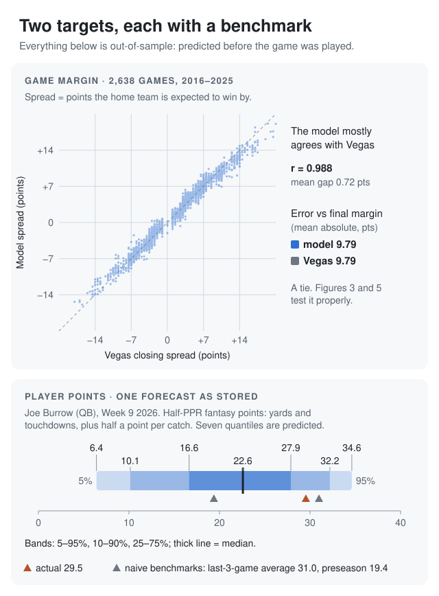
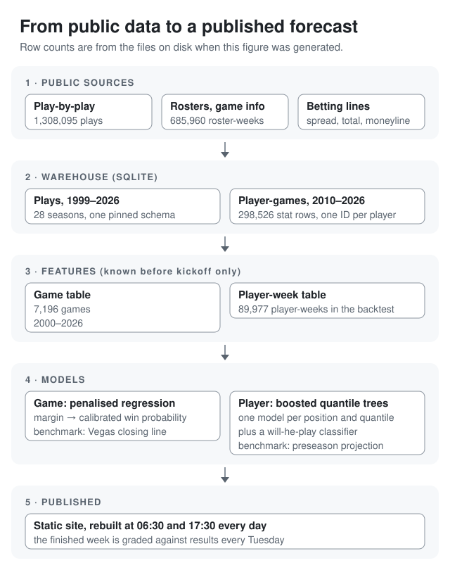
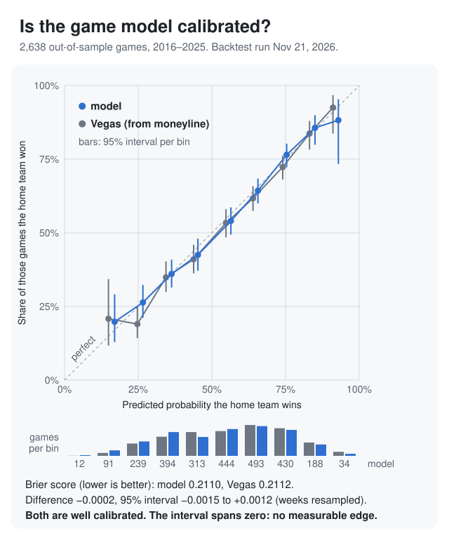
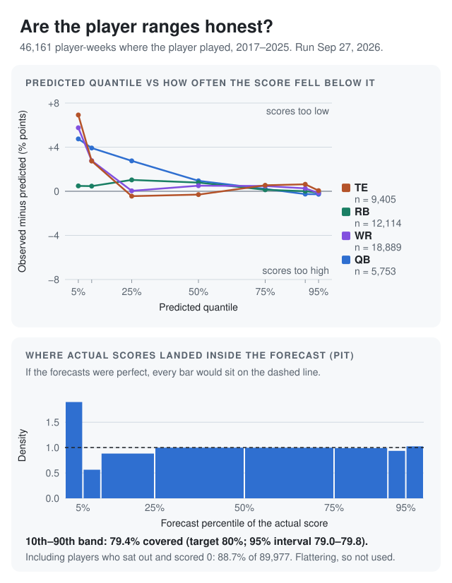
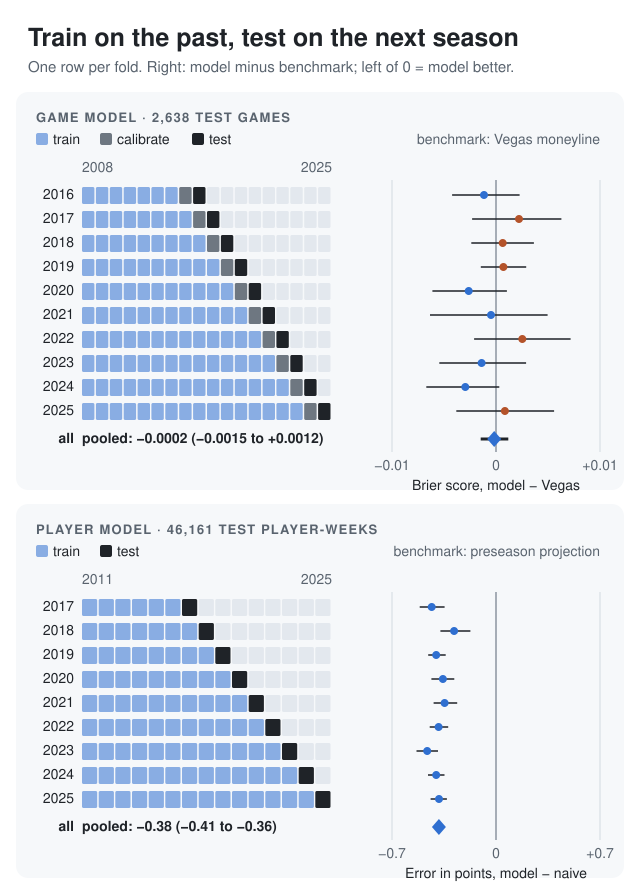
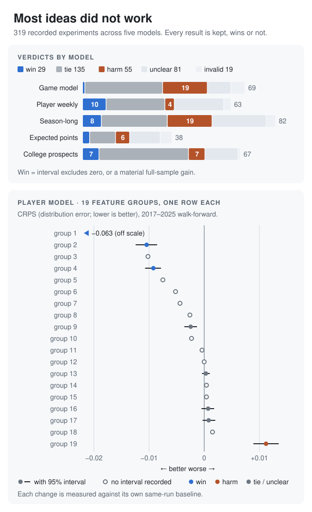

# nfl_predictor

Two forecasting models for the NFL, built on public data and scored only on games they had not seen: one predicts game outcomes and is benchmarked against the Vegas line, the other predicts a range of weekly fantasy points for every player.

Figures are generated by [`docs/img/make_figures.py`](docs/img/make_figures.py) from stored backtest output. They follow your system light or dark setting.

### 1. What is predicted, and against what?

The game model lands within a point of the Vegas line on average and is no more accurate than it. Player forecasts are seven quantiles, not a single number.

### 2. How does data become a forecast?

About 1.3 million plays become one table of games and one of player-weeks, using only information available before kickoff.

### 3. Is the game model calibrated?

When the model says 70%, the home team wins about 70% of the time. So does Vegas: the Brier difference is −0.0002 with an interval that spans zero, so there is no measurable edge.

### 4. Are the player ranges honest?

The middle of the distribution is well calibrated, with the 80% band covering 79.4%. The bottom tail is not: for quarterbacks, receivers and tight ends, scores fall below the predicted 5th percentile about twice as often as they should.

### 5. How is it evaluated?

Each season is predicted by a model trained only on earlier seasons. The game model ties Vegas (better in 5 of 10 seasons); the player model beats the stronger of two naive baselines in all nine, by 0.38 points of absolute error among players who played.

### 6. What was tried and did not work?

Of 319 recorded experiments, 29 were wins. Most ideas measured neutral or harmful, and every result is kept so a dead idea is not tried twice.

---

## How it's built

- **Data:** public NFL play-by-play, roster and schedule data back to 1999, plus closing betting lines, stored in a local SQLite warehouse.
- **Game model:** penalised regression predicting the final margin, converted to a calibrated win probability. It is trained on every season since 2008 and refit before each week.
- **Player model:** gradient-boosted quantile trees, one set per position, combined with a model of whether the player suits up.
- **Evaluation:** every number above comes from walk-forward backtests: each season is predicted by a model that has only seen earlier seasons. Live weeks are graded the same way every Tuesday.
- **Site:** written in R, exported to JSON and served as a React app at https://nfl-predictor-mf4-cjl.pages.dev, rebuilt twice a day during the season.

The project started in 2022; that season's predictions are in [this sheet](https://docs.google.com/spreadsheets/d/1bBT9MqBJO8FUqHRNk33IfHDlvAMWZS-NBgruz5EKhe8/edit#gid=1401699762).
